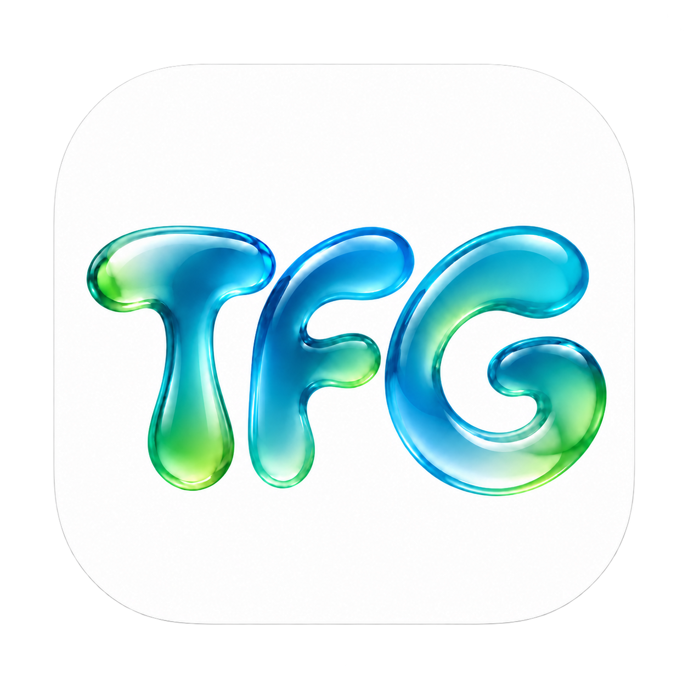
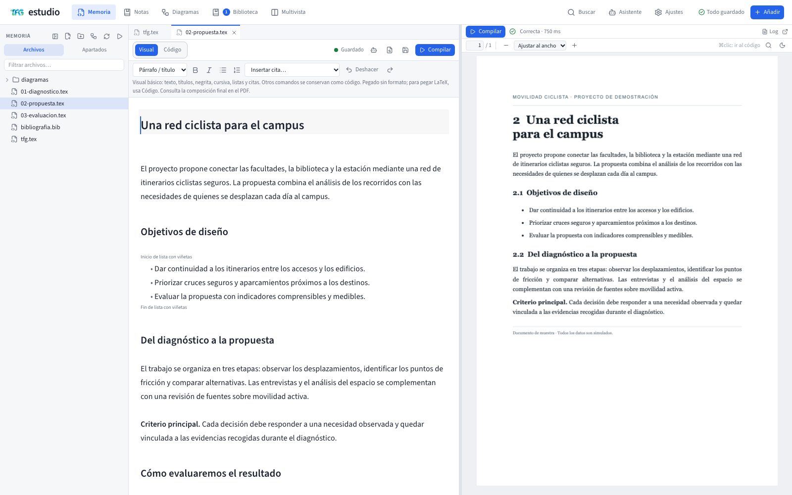
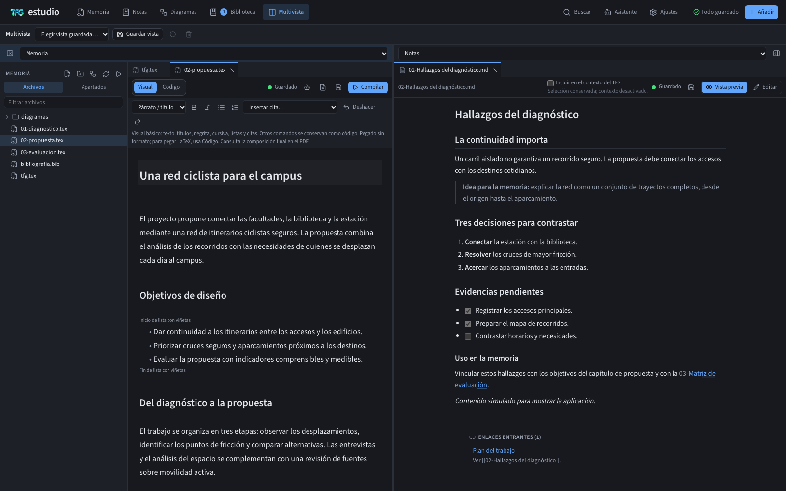
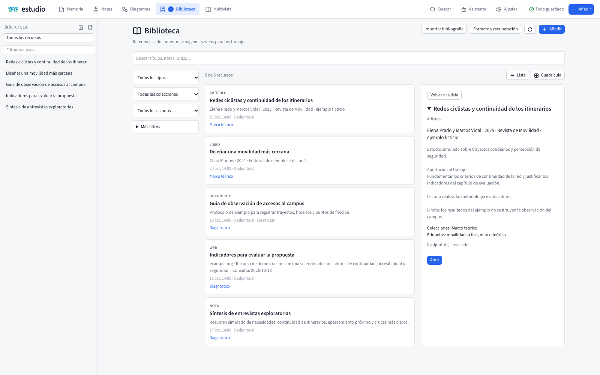
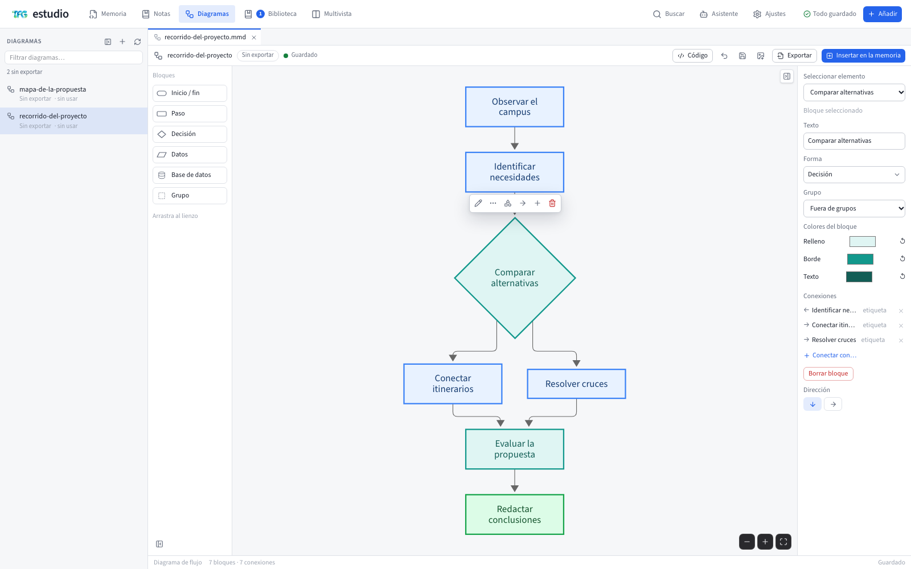
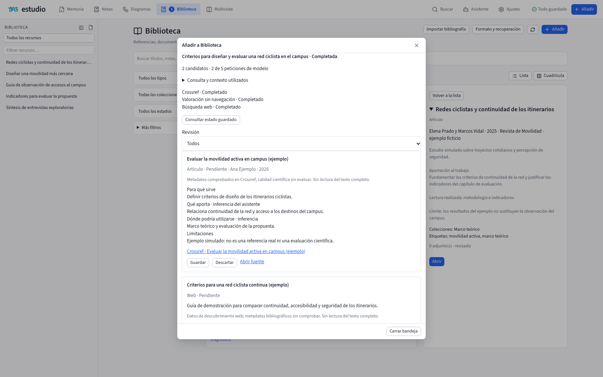

<p align="center">
  
</p>

<h1 align="center">Estudio TFG</h1>

<p align="center">
  Escribe la memoria en LaTeX con el PDF al lado, consulta tus notas de Obsidian<br>
  y organiza fuentes y diagramas para incorporarlos al documento. Tus archivos viven en tu equipo.
</p>

<p align="center">
  <a href="https://github.com/JavierLoro/estudio-tfg/releases"><strong>Descargar la app</strong></a> ·
  <a href="#un-recorrido-por-estudio-tfg">Ver cómo se trabaja</a> ·
  <a href="docs/README.md">Guía técnica</a> ·
  <a href="docs/HOJA-DE-RUTA.md">Hoja de ruta</a>
</p>

<p align="center">
  <a href="https://github.com/JavierLoro/estudio-tfg/actions/workflows/ci.yml"></a>
</p>

[](docs/imagenes/memoria-visual.png)

## Un recorrido por Estudio TFG

Las capturas muestran un **proyecto ficticio sobre movilidad ciclista en un campus**. Los documentos, las referencias y el PDF son de demostración; la búsqueda utiliza un proveedor simulado. [Detalles de las capturas](docs/imagenes/README.md).

### Escribe sin perder de vista el resultado

Redacta títulos, párrafos, listas y citas en **Visual**, y pasa a **Código** cuando necesites fórmulas, macros o estructuras avanzadas de LaTeX. El PDF permanece al lado: ajusta su ancho, busca texto y navega entre el documento y su página.

### Ten tus notas al lado de lo que escribes

Abre tus apuntes de Obsidian, sigue sus enlaces y recupera una idea mientras redactas. **Multivista** combina dos apartados, permite ajustar el espacio de cada uno y guarda tus distribuciones favoritas. La app se adapta al tema claro u oscuro del sistema.

[](docs/imagenes/multivista-notas.png)

### Importa archivos y conecta ideas

Arrastra archivos a la app o pulsa **Importar archivos** y elige Biblioteca, Memoria o Notas. Si los sueltas sobre una carpeta, se preselecciona ese destino; en un editor LaTeX o Markdown, puedes insertar figuras o enlaces según el formato. Los originales se conservan y los nombres ocupados se resuelven sin sobrescribir.

En **Biblioteca**, reúne artículos, documentos, imágenes y webs, e importa referencias BibTeX, RIS o DOI. El **Mapa de contenidos** organiza temas con nodos internos y vínculos a esas fichas. Desde cada nodo puedes llevar citas, figuras, notas y enlaces a la memoria. Quitar una rama conserva sus recursos y las copias ya incorporadas. [Cómo organizar Biblioteca](docs/BIBLIOTECA.md#organizar-contenidos-en-un-mapa).

[](docs/imagenes/biblioteca.png)

### Dale forma a una idea antes de explicarla

En **Nuevo diagrama**, elige el editor:

- **Mermaid:** quince tipos de diagrama, con controles visuales, formularios y código. Exporta PDF vectorial.
- **Excalidraw:** lienzo en blanco y seis plantillas con elementos editables, para dibujar y añadir imágenes sin Internet. Exporta SVG y PDF como imagen a **300 ppp**; el texto de ese PDF no es seleccionable.

Ambos permiten **insertar la figura en la memoria** eligiendo apartado, pie y ancho, y conservan la fuente editable. Los diagramas de Biblioteca se copian a Memoria sin modificar el original. [Uso, guardado y límites](docs/README.md#diagramas).

[](docs/imagenes/diagramas.png)

### Encuentra fuentes y decide qué incorporar

El **asistente opcional con tu cuenta de ChatGPT** permite consultar selecciones y documentos, preparar cambios y generar propuestas de diagramas. Puedes definir el contexto del TFG y elegir sus fuentes: conectar una cuenta no concede acceso automático a tus archivos.

En **Buscar con asistente**, describe lo que necesitas y revisa los candidatos antes de incorporarlos a Biblioteca. La bandeja muestra su procedencia, posible aportación y limitaciones; tú eliges qué guardar o descartar. La búsqueda combina ChatGPT, cuando la cuenta y el modelo admiten navegación, con Crossref para referencias académicas.

[](docs/imagenes/busqueda-asistida.png)

<p align="center"><sub>Demostración con IA y fuentes simuladas. La disponibilidad real del asistente y de la búsqueda web depende de la cuenta, el modelo y el plan.</sub></p>

[Conoce el asistente y sus permisos](docs/ASISTENTE.md) · [Guía de Biblioteca](docs/BIBLIOTECA.md)

## Tus archivos, tu forma de trabajar

Tu memoria y tus notas viven en las carpetas que eliges: fuentes LaTeX, notas Markdown, referencias BibTeX y diagramas Mermaid o Excalidraw. Conserva la memoria completa, con sus figuras y fuentes editables, para trasladarla y compilarla sin depender de la Biblioteca original.

La compilación del PDF se realiza localmente y puede funcionar sin conexión una vez preparado el motor. Si conectas el asistente, las consultas y fuentes que autorices se envían a OpenAI.

Historial de guardados, borradores recuperables y detección de conflictos te ayudan a retomar el trabajo. Para proteger el conjunto, consulta la [guía de copias de seguridad](docs/RESPALDO.md).

## Instalar la app de escritorio

Disponible para **macOS, Windows y Linux**, con dos variantes: **completa / offline** y **ligera / online**. La app instalada prepara su motor de compilación; no necesitas instalar Node, Docker ni TeX por separado.

**[Ir a las descargas →](https://github.com/JavierLoro/estudio-tfg/releases)**

<details>
<summary><strong>Ver cómo descargarla e instalarla</strong></summary>

1. Abre [GitHub Releases](https://github.com/JavierLoro/estudio-tfg/releases) y elige el paquete de tu sistema y arquitectura.
2. Elige **completa / offline** para preparar TeX sin conexión, o **ligera / online** para descargarlo la primera vez. Después, ambas compilan localmente sin red.
3. En macOS, abre el `.dmg` y arrastra la app a Aplicaciones. En Windows, utiliza el instalador `.exe` o la variante portable. En Linux, abre la `.AppImage` con permiso de ejecución.
4. Sigue el asistente inicial para elegir tus carpetas, crear la memoria y preparar el primer PDF.

Las versiones actuales se distribuyen sin firma digital ni notarización y pueden mostrar avisos del sistema. Consulta los [pasos de instalación, compatibilidad y avisos por plataforma](docs/README.md#instalar-la-app-de-escritorio).

</details>

## Empieza con tu memoria

<details>
<summary><strong>De un proyecto nuevo a tu primer PDF</strong></summary>

1. **Elige tus carpetas.** Usa un vault de Obsidian existente o crea notas nuevas. Selecciona también dónde guardar la memoria.
2. **Prepara el documento.** Crea una memoria desde una plantilla y completa título, autor y tutor en **Datos del trabajo**.
3. **Redacta.** Abre un capítulo y elige Visual o Código. Guarda y pulsa **Compilar** para actualizar el PDF de la derecha.
4. **Añade tus fuentes.** En **Biblioteca**, añade documentos, imágenes, webs y referencias. Revisa sus datos, organízalos en el Mapa de contenidos e inserta citas, figuras, notas y enlaces en la memoria.
5. **Crea tus diagramas.** En **Nuevo diagrama**, elige Mermaid o Excalidraw, edita y pulsa **Insertar en la memoria**. La figura y su fuente editable quedan en el proyecto.

Las carpetas y el motor se pueden cambiar desde **Ajustes**. [Consulta la guía de uso completa](docs/README.md#qué-puedes-hacer).

</details>

<details>
<summary><strong>Organiza tu espacio y trabaja con el asistente</strong></summary>

- Abre **Multivista**, elige un apartado a cada lado y ajusta el separador. **Guardar vista** permite recuperar esa distribución después.
- Usa **Buscar** o `⌘K` / `Ctrl+K` para localizar archivos, recursos y texto.
- Abre el **Asistente**, conecta una cuenta elegible y revisa los permisos en Ajustes. Puedes empezar una consulta desde el menú contextual de una selección o documento.
- Revisa las propuestas de edición antes de aplicarlas. Conectar la cuenta no concede acceso automático a tus archivos.

[Funciones y atajos](docs/README.md#qué-puedes-hacer) · [Asistente y permisos](docs/ASISTENTE.md)

</details>

## Ejecutarlo desde el código

<details>
<summary><strong>Probar la app de escritorio en desarrollo</strong></summary>

Necesitas **Node 24 o posterior** y npm. Desde una terminal:

```bash
git clone https://github.com/JavierLoro/estudio-tfg.git
cd estudio-tfg
npm run install:all
npm install --prefix desktop
npm run desktop:dev
```

Al guardar cambios en el código, el entorno reconstruye la app y solicita su recarga o reinicio. Conserva un perfil separado en `workspace/desktop-dev/`, con documentos de prueba iniciales. Si seleccionas otras carpetas, los archivos se editan en su ubicación real.

La primera preparación del motor requiere conexión; después se reutiliza. Este comando abre la app de desarrollo sin generar instaladores. [Detalles del entorno de escritorio](desktop/README.md).

</details>

<details>
<summary><strong>Levantar la versión web con Docker o Node</strong></summary>

Puedes alojar Estudio TFG en tu propio equipo o servidor y acceder desde el navegador.

- **Con Docker:** sigue la [configuración de carpetas y el arranque con Compose](docs/README.md#usarlo-con-docker-windows-mac-linux).
- **Con Node:** sigue el [arranque nativo de servidor y web](docs/README.md#desarrollar-server-y-web-nativos), con Docker o TeX como motor de compilación.

La conexión con tu cuenta de ChatGPT está disponible en la app de escritorio. [Consulta las diferencias y requisitos por plataforma](docs/PLATAFORMAS.md).

</details>

## Un proyecto abierto, en evolución

Consulta las notas de cada release para conocer su alcance y la [hoja de ruta](docs/HOJA-DE-RUTA.md) para ver lo que viene después.

¿Quieres contribuir? Empieza por la [guía técnica](docs/README.md#contribuir), las [reglas del repositorio](AGENTS.md) y la [especificación del producto](docs/CONTRACT.md).

Estudio TFG se distribuye bajo [AGPL-3.0](LICENSE). La plantilla conserva la licencia y atribución de su base ARCO; los [créditos y componentes de terceros](docs/README.md#licencia) están en la guía técnica.
